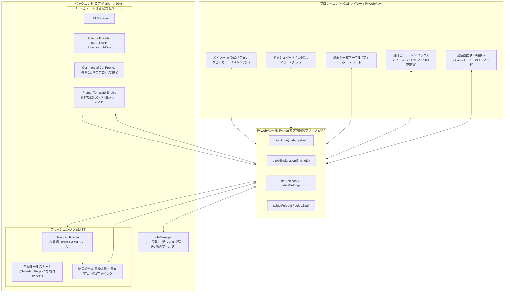

# システムアーキテクチャ設計書 (CodeChecker Architecture)

## 1. 概要 (Overview)
CodeChecker は、ソースコードのセキュリティ脆弱性を静的解析とAI（LLM）のハイブリッドアプローチで高精度に診断し、修正提案を提示するクロスプラットフォーム対応のデスクトップアプリケーションです。

---

## 2. 全体アーキテクチャ図 (System Architecture)

---

## 3. 主要コンポーネントの責務

### 3.1 フロントエンド (UI)
- **テクノロジー**: HTML5 / CSS3 (Tailwind CSS CDN) / Vanilla JavaScript / Prism.js (構文ハイライト) / Diff2Html (差分表示)
- **責務**:
  - ユーザーからのフォルダ選択・ZIPファイルドラッグ＆ドロップの受付
  - 解析進行状況（プログレスバー・スキャン中ファイル名）のリアルタイム表示
  - 高・中・低の危険度別サマリーカードおよび一覧テーブルのレンダリング
  - 選択した脆弱性のコード箇所ハイライト表示
  - AIによる日本語解説と、安全なコードへの修正差分（Before / After Diff）の視覚化
  - レポート（HTML/Markdown）の一括エクスポート

### 3.2 PyWebView ブリッジ API (`api.py`)
- PythonネイティブのオブジェクトメソッドをJavaScriptから直接 `window.pywebview.api.methodName()` で呼び出し可能にする仲介層。
- ファイルダイアログの起動、スキャンの非同期実行、進捗通知イベント、AI解説生成のトリガーを仲介。

### 3.3 ファイルマネージャー (`file_manager.py`)
- 指定されたディレクトリまたはZIPファイルを走査。
- ZIPファイルの場合は安全なテンポラリディレクトリ（`tempfile.mkdtemp`）に安全に解凍（Zip Slip脆弱性防止対策を含む）。
- `.git`, `node_modules`, `vendor`, `__pycache__`, `.venv`, バイナリファイル等の不要なディレクトリ・拡張子を自動除外。

### 3.4 スキャンエンジン (`engine.py`)
- **ハイブリッド静的解析**:
  - **Semgrep Runner**: `semgrep scan --json --config auto` などを呼び出し、多言語にわたるOWASP Top 10/CWE脆弱性を検出。
  - **Built-in Scanner**: ハードコードされたシークレット（APIキー、パスワード、秘密鍵）や代表的な危険関数呼び出し（`eval`, `system`, `shell_exec`, SQL文字列連結など）を即座に検出。
- **重大度（Severity）のマッピング**:
  - `HIGH / CRITICAL` → **危険度：高**（即時修正が推奨される深刻な脆弱性）
  - `MEDIUM / WARNING` → **危険度：中**（悪用条件付き、または潜在的な不具合）
  - `LOW / INFO` → **危険度：低**（ベストプラクティス違反、コード品質改善）

### 3.5 AI解説・修正提案モジュール (`ai/`)
- **LLMManager**: ユーザー設定に応じて `OllamaProvider`、`CLIProvider`、または `NoopProvider`（AI無効）へルーティング。
- **OllamaProvider**: ローカルのOllamaサーバー（`http://localhost:11434`）へHTTP通信。モデル一覧の動的取得（`/api/tags`）やストリーミング・一括生成（`/api/generate` または `/api/chat`）を担当。
- **DedicatedCLIProvider**: OpenAI Codex CLI（`codex exec --skip-git-repo-check -`）にプロンプトをパイプ渡し（引数リスト・`shell=False`）し、標準出力を受け取るアダプター。

---

## 4. データフロー (Data Flow)

1. **入力**: ユーザーがディレクトリ選択 or ZIPファイルをドロップ
2. **展開 & ファイル走査**: ファイルツリー作成、不要ファイル除外
3. **静的スキャン**: Semgrep + 内蔵ルールで並行スキャン
4. **一次結果表示**: 検出された脆弱性リスト（高中低に分類）を即座にUIへ反映
5. **オンデマンドAI解説**:
   - ユーザーが脆弱性をクリック（または一括AI解析ボタンを押下）
   - 対象ファイルの該当行および前後20〜30行のコードスニペットを抽出
   - 選択されたLLMプロバイダ（Ollama / CLI）へプロンプト送信
   - AIから「① 原因とリスクの要約」「② 修正方針」「③ 推奨修正コード(Diff形式)」を受信し、UIに描画
6. **レポート出力**: 解析結果とAI解説を統合したレポートをMarkdown / HTMLで出力

