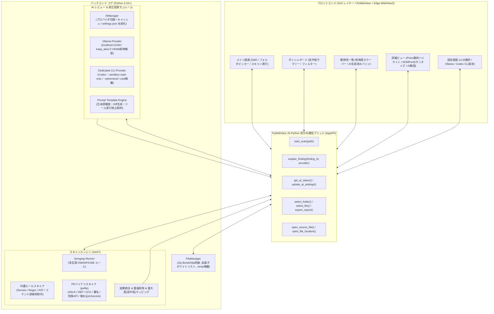

# システムアーキテクチャ設計書 (CodeChecker Architecture)

## 1. 概要 (Overview)
CodeChecker は、ソースコードおよび Windows PE バイナリのセキュリティ脆弱性を静的解析（SAST）と AI（LLM）のハイブリッドアプローチで高精度に診断し、具体的な修正提案を提示するクロスプラットフォーム対応のデスクトップアプリケーションです。

---

## 2. 全体アーキテクチャ図 (System Architecture)

---

## 3. 主要コンポーネントの責務

### 3.1 フロントエンド (UI)
- **テクノロジー**: HTML5 / CSS3 / ES6+ Vanilla JavaScript / Tailwind CSS (完全ローカルバンドル) / FontAwesome (ローカル) / Prism.js (構文ハイライト) / Marked.js / DOMPurify (サニタイズ)
- **責務**:
  - ユーザーからのフォルダ選択・ファイル選択・ZIP/バイナリのドラッグ＆ドロップ受付
  - スキャン実行時のぼかしオーバーレイロックおよび進捗バーのリアルタイム表示
  - 高・中・低の危険度別サマリーカードおよび一覧リストのレンダリング
  - 選択した脆弱性のコード箇所ハイライト表示（拡張子に応じた自動言語切替）
  - DOMPurify による安全なAI解説・修正差分の描画
  - 非同期リクエスト競合ガード（`explanationRequestId`）による表示破綻防止
  - レポート（HTML/Markdown）の一括エクスポート

### 3.2 PyWebView ブリッジ API (`api.py`)
- PythonネイティブのオブジェクトメソッドをJavaScriptから直接 `window.pywebview.api.methodName()` で呼び出し可能にする仲介層。
- ファイルダイアログの起動、スキャンの非同期実行、進捗通知イベント（`on_progress`）、AI解説生成のトリガーを仲介。
- ソースコードエディタ連携（VS Code / 既定エディタ）およびバイナリ向けエクスプローラー連携（`open_file_location`）を提供。

### 3.3 ファイルマネージャー (`file_manager.py`)
- 指定されたディレクトリ、単一ファイル、またはZIPアーカイブを走査。
- **Zip Bomb & Zip Slip 多層防御**: 展開前メタデータ検証（総サイズ200MB、ファイル数1,000件、単一100MB、圧縮率200倍）および展開中実ストリーム二重検査。
- **拡張子ホワイトリスト (PERF-01)**: プログラミング言語ファイルのみを収集し、巨大データ・ログファイルを除外してスキャンを大幅高速化。
- **アプリ内一時フォルダ隔離**: ZIP展開領域を `.temp/` 配下に隔離し、スキャン完了時・起動時に安全クリーンアップ。

### 3.4 スキャンエンジン (`engine.py`)
- **多言語静的解析 (Semgrep)**: 多言語（30+言語）にわたるOWASP Top 10/CWE脆弱性を検出。
- **内蔵セキュリティルール (Built-in Rules)**: ハードコードされたシークレット、危険なコマンド実行、危険なデシリアライズ、SQLインジェクション、eval/execなどを高速検出。安全なリスト引数は誤検知から除外。
- **PEバイナリ診断 (pefile)**: Windows実行可能バイナリ（EXE/DLL）のエクスプロイト緩和策（ASLR/DEP/CFG/署名）、危険なAPIインポート、埋め込みシークレット、マニフェスト特権を静的構造解析。
- **重複排除と重大度集計**: 同一行の複数指摘をロストせず保持（BUG-01対策）し、HIGH/MEDIUM/LOWに集約。

### 3.5 AI解説・修正提案モジュール (`ai/`)
- **AIManager**: ユーザー設定に応じて `OllamaProvider`、`DedicatedCLIProvider`、または `disabled` へルーティング。同一指摘に対するキャッシュ管理およびアプリ内 `settings.json` へのポータブル保存。
- **OllamaProvider**: ローカルのOllamaサーバー（`http://localhost:11434`）へHTTP通信。プロバイダ切替時や終了時に `keep_alive: 0` でVRAMを即時解放。
- **DedicatedCLIProvider**: OpenAI Codex CLI（`codex exec --sandbox read-only --ephemeral --skip-git-repo-check -`）へ引数リスト・`shell=False`・標準入力パイプで安全通信。カレントディレクトリを空の `.temp/cli_sandbox/` に隔離。

---

## 4. データフロー (Data Flow)

1. **入力**: ユーザーがディレクトリ選択、ZIPファイル、またはEXE/DLLをドロップ。
2. **準備**: `FileManager` が一時展開（ZIP時）またはファイル収集を実行。
3. **静的解析**:
   - ソースコード: `SemgrepRunner` + `BuiltinRules` で走査。
   - PEバイナリ: `PEScanner` でヘッダー・テーブル構造を走査。
4. **統合**: `Aggregator` が結果を統合、CWEタイトル付与、重複排除を実行してUIへ返却。
5. **AI解説生成**:
   - ユーザーが指摘を選択時、`AIManager` が対象コードのスニペット（前後15行）を抽出し、プロンプトを構築。
   - 選択されたAI（Ollama / Codex CLI）が安全な通信経由で推論し、Markdownを返却。
6. **安全描画**: Marked.js + DOMPurify でサニタイズされたHTMLをUI詳細ペインにレンダリング。
